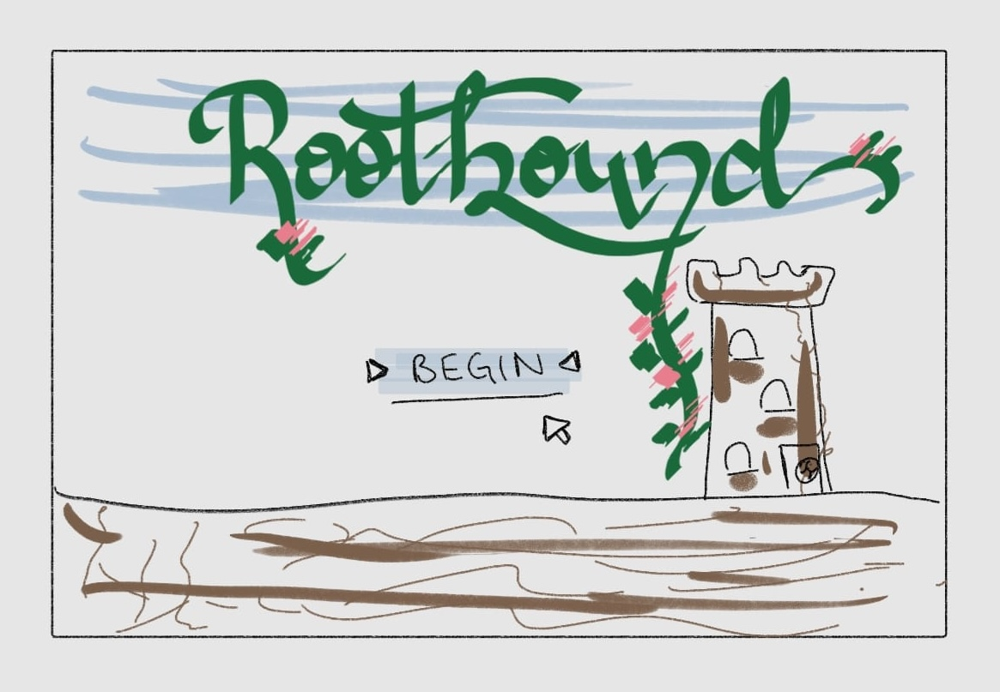
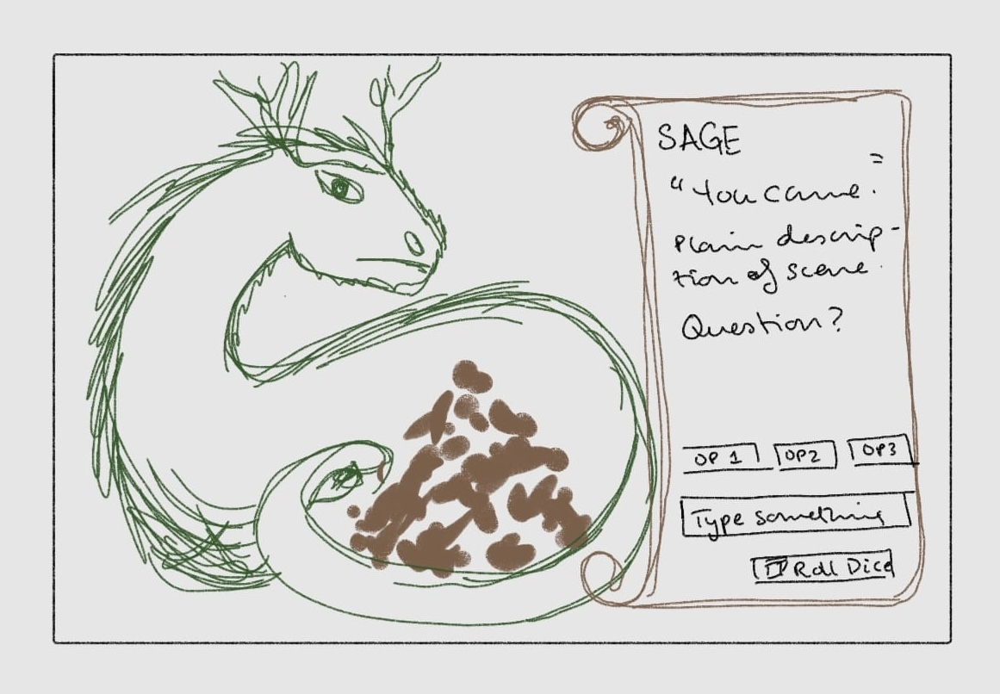
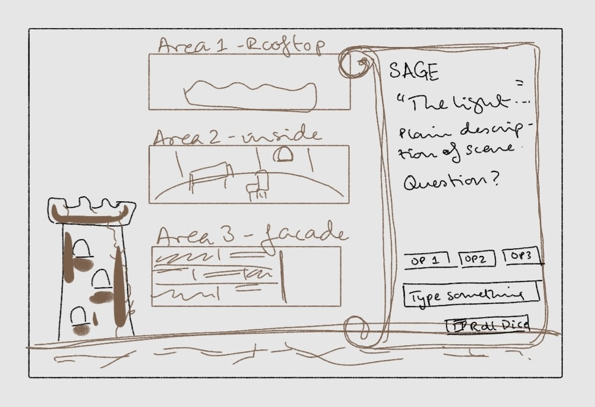
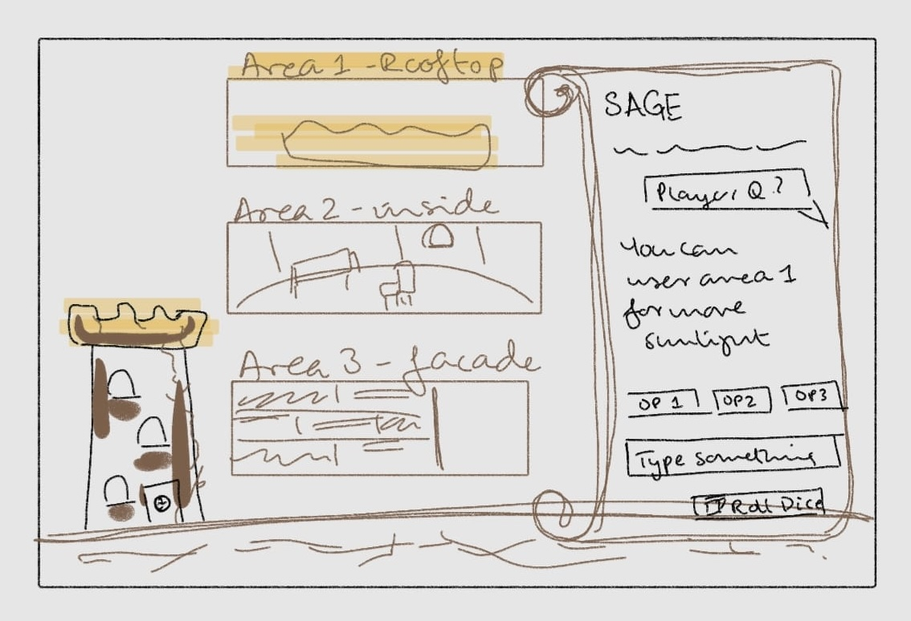
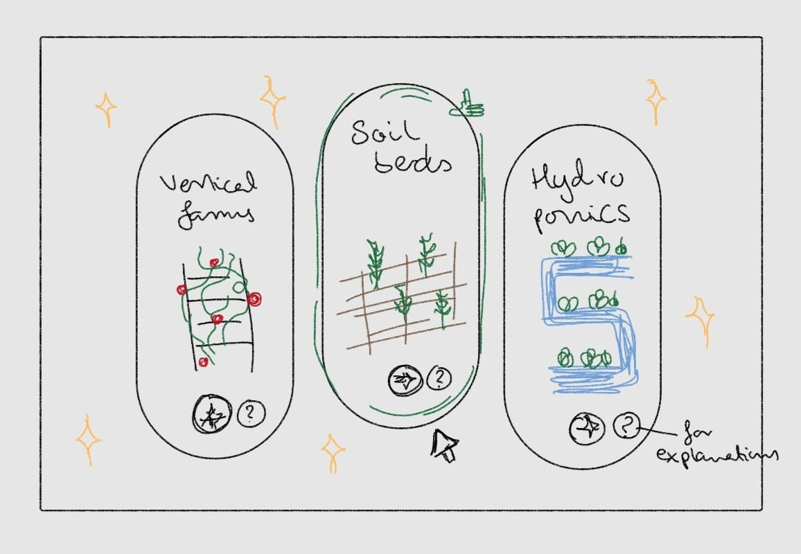

# 🎲 Project Proposal & Storyboard

## Project Description:

**Title**: Rootbound

**Storyline**: The city of Hungerfell is starving after the Great Drought. The player is an apprentice Tower-Warden who must build farming towers that feed the city without draining its water and power. This game is inspired by the mechanics of Dungeons and Dragons.

**Guide (AI Chatbot)**: Sage, an ancient dragon who hoards seeds instead of gold. Sage is the Dungeon Master: wise, ominous, and always guiding the player toward better decisions.

**Research** **question**: Does a gamified, AI-guided experience help non-technical people understand complex multi-criteria tradeoffs better than plain charts, without feeling overwhelmed?

## Sage - the Dungeon Master:

Sage is a wise but ominous dragon that speaks in omens, which will bring an eerie, mystical vibe to the game. However, every omen and dialogue from Sage will carry real information, eg, if Sage says *"the sky will crack open and weep heavily tonight"* that means there’s going to be a heavy thunderstorm, so account for its effect on crops, water and light. Sage basically leads like a DM, in that it builds the story-world, explains the rules, nudges players toward good choices, but in the end, it always has to be the player who makes the decisions for their farming towers. (haven’t decided pronouns for Sage yet, maybe fae / faer?)

Sage will have 4 roles (I might change this later based on scope / limitations of the project):

1. **Storyteller:** Sage builds the world and Hungerfell reacts to choices (villagers thrive or leave, areas turn green or grey). Sage will remembers past choices and all choices affect the visual representation of the world, including on the tower, sky and surroundings.
2. **Rules keeper:** Players can turn to Sage to explain how things work, like the stars in the sky, sigils (data visualizations like graphs), the Ouroboros (visual representation of resource circularity), and artifacts (tools, BIA systems, etc).
3. **Advisor:** Sage previews consequences, points out tradeoffs, recommends. Examples of what players can ask:
    - *"Why isn't my water being reused?"*
    - *"What does the sigil mean and how can I improve it?"*
    - *"I rolled and got two options. How do they help me?"*
4. **Questioner:** To keep players thinking, and making choices instead of blindly following suggestions, Sage will sometimes answers with a question (*"What matters more tonight, bread or water?"*). Sage will also never give the solution outright to the user.

Sage (AI chatbot) will be designed to use the following structure for all messages / dialogue.

1. Omen (an ominous / eerie message)
2. Plain explanation (what's actually happening, in simple words, decoding the message)
3. Question + chips (which will keep the player exploring / engaged)

(Optional) We’ll also highlight the relevant element in the world while Sage speaks, for example, a tower floor, or some vines growing on the tower wall, or water flow, etc.

**Workflow:**

1. Sage sets the scene with an omen + context.
2. Players can then:
    - Decide directly and choose from the options / chips.
    - Ask Sage and get advice tailored to their quest and tower so far.
    - Roll the dice (like in a board game) when stuck and Sage will generates 2–3 options (Artifacts) for them.
3. Tower updates based on their choices, and the world changes. Sage can explain the effects.
4. Sage ends with a question + chips per prompt / decision.

## The Farming Tower

We’ll have 6 parts of the tower that can be influenced by player choices that correspond directly with BIA scenario variables.

1. The Ground: locations like rooftop, facade, indoors
2. The Seeds: crops like leafy greens, fruits, mushrooms, vegetables etc
3. The Roots: BIA growing systems, like greenhouses, soil-beds, hydroponics
4. The Veins: Water like grey water, fresh water, rain water
5. The Fire: Energy, like solar, grid, wind
6. The Loop: Circularity: composting, reuse, water and energy reuse

There are sigils on the doors of these farming towers which will basically be radar chart in which each spike is a KPI. KPIs can be yield, energy, water use, cost, carbon emissions, resource circularity etc (I will come up with mythical names for these later to better fit the game). Users can also review a choice before committing by looking at what their towers sigil would look like with the choice taken.

## Storyboards

### Frame 1 : Title Screen

**Description:** A gloomy Hungerfell skyline is shown and cracked dry earth, with an empty, broken farming tower in the back and the Rootbound logo in the sky.
**Interaction:** `[Begin]`

### Frame 2: Sage Wakes

**Description:** Sage is shown hoarding seeds in a cave. A scroll displays the dialogue, descriptions, a chat bar, and dice interactions + option chips.

*"You came. They always come when the bread runs out."*
The city is starving. You will build a tower that feeds it, without drinking it dry.
**Where shall your tower stand?**

**Interactions:** `[→ The Ground]` `[Who are you?]` `[What is a tower?]`

### Frame 3: The Tower

**Description:** Once the ground is chosen, a map of three sites in the tower is shown: a rooftop, a building facade, a dark indoor floor. Light rays can be shown in appropriate places.

*"The light falls unevenly here. Some places are blessed. Some are forgotten."*
Rooftops get the most sun but face storms. Indoor floors are sheltered but need more energy for light.                               
**Do you fear the storm, or the dark?**

**Interactions:** `[Rooftop]` `[Facade]` `[Indoor]` `[Ask Sage - Chatbox]` `[🎲 Let fate decide]`

### Frame 4: Ask Sage Interaction

**Description:** The player's text box is shown with the question *"which one should I pick?"*. The rooftop site glowing (recommended by the AI chatbot - Sage).

*"You seek bread above all. Then go where the light is."*
For your quest (feeding the village), the rooftop gives the most free light. Watch the weather though.
**Will you trust me?**

**Interactions:** `[Rooftop]` `[Why not indoor?]` `[What storms?]`  `[🎲 Let fate decide]`

### Frame 5: Dice Roll Interaction

**Description:** The Player is stuck on choosing options. So they click the “roll dice” interaction which causes three artifact cards to be shown, with an option to view predicted sigils (radar chart - for evaluations of benefits or losses), as well as a recommended card highlighted + an 👍 emoji.

*"Fate has spoken. Three gifts lie before you. Only one may be taken."*
These are three growing systems. The ghost shapes show how your tower would change with each.
**Which shape do you want your tower to wear?**

**Interactions:** `[Hydroponics]` `[Aquaponics]` `[Soil beds]` `[Explain all three]`

